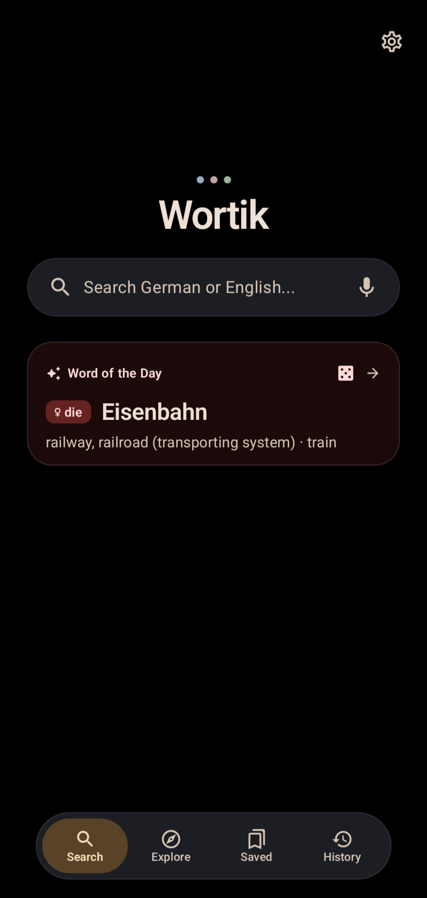
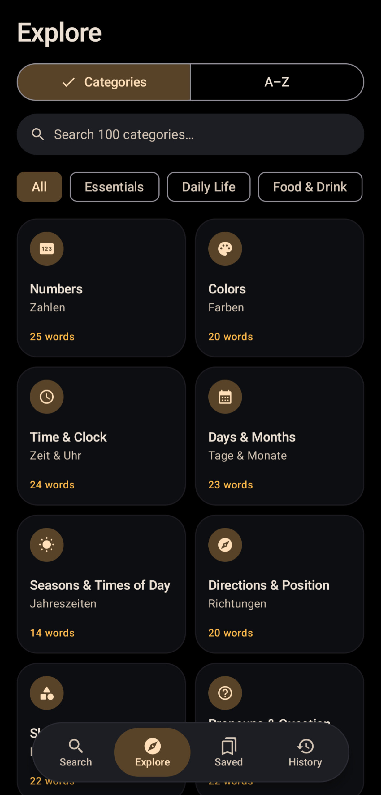
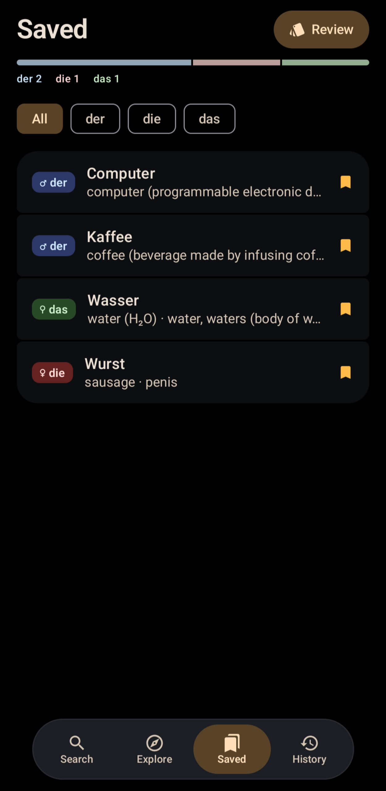
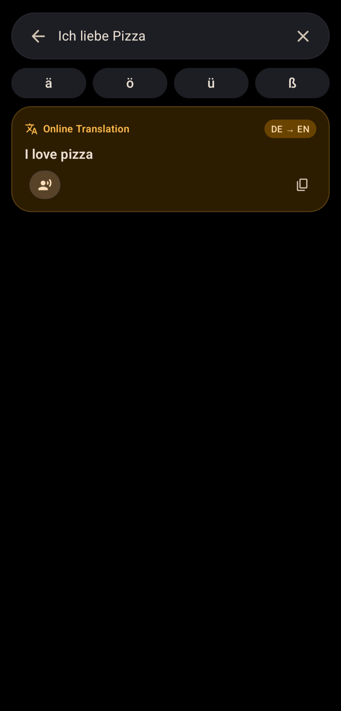
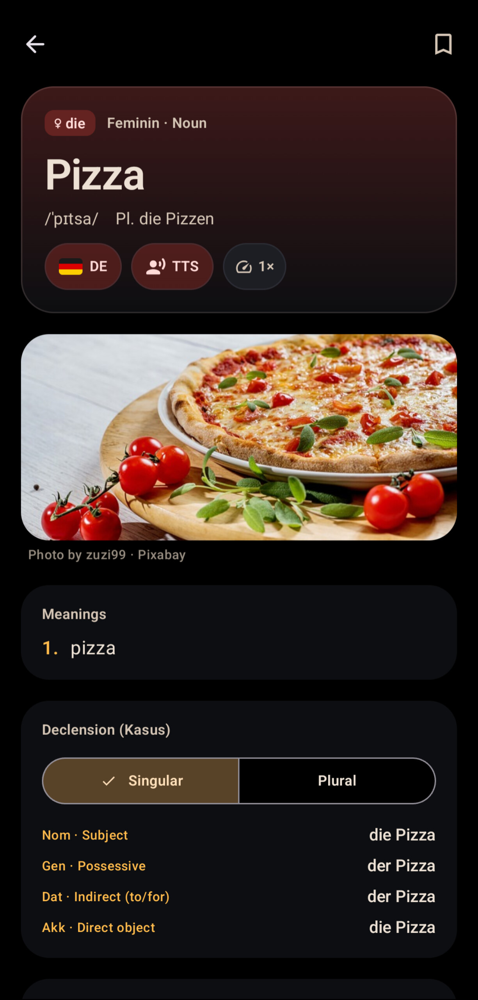
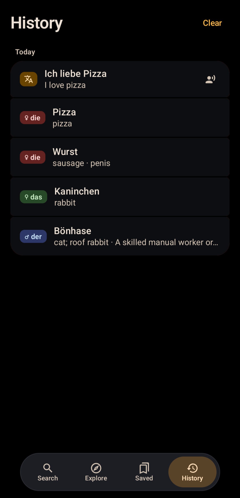

<div align="center">
  
  <h1>Wortik</h1>
  <p><strong>Offline-first German–English dictionary for Android</strong></p>

  <p>
    
    
    
    <a href="LICENSE">
      
    </a>
  </p>

  <p>
    <a href="releases/Wortik-v1.0.0.apk"><strong>Download APK (v1.0.0)</strong></a>
  </p>
</div>

---

## Screenshots

| Home & Word of the Day | 100 Categories & A–Z | Saved & Gender Ratio |
| :---: | :---: | :---: |
|  |  |  |

| Sentence Translation | Word Details & Kasus | History & Translation Log |
| :---: | :---: | :---: |
|  |  |  |

---

## Features

- **97,000+ Offline Words** — Fast Room + SQLite FTS4 search with smart umlaut handling (`ä/ö/ü/ß`) and voice search (`de-DE`).
- **Color-Coded Genders** — Harmonized Material You colors for `der` / `die` / `das`.
- **Grammar Tables** — Noun declensions (*Kasus*) and verb conjugations (*Präsens, Präteritum, Perfekt*).
- **Pronunciation** — Native German audio + offline Android TTS with `0.75× / 1×` speed control.
- **Explore** — 100 curated vocabulary categories + alphabetical A–Z browser.
- **Flashcards & History** — 3D-flipping flashcards, gender stats, and searchable word + sentence history.
- **Online Translation** — Instant DE ⇄ EN fallback for sentences and out-of-dictionary words.
- **Material You Themes** — Dynamic Color, 6 custom palettes, and AMOLED True Black.

---

## Tech Stack

- **UI:** Kotlin, Jetpack Compose, Material 3, Coil
- **Architecture:** MVVM + Repository pattern, Hilt DI, Coroutines & Flow
- **Storage:** Room (pre-populated FTS4 dictionary DB + separate user-data DB), DataStore Preferences
- **Tests:** JUnit 4 unit tests

---

## Build

```bash
git clone https://github.com/sajadrahimi-dev/Wortik.git
cd Wortik
./gradlew testDebugUnitTest assembleDebug
```

*(Optional)* Add `PIXABAY_API_KEY=your_key` to `local.properties` to enable noun photos.

---

## Credits & License

- Dictionary data: [Wiktionary](https://www.wiktionary.org/) via [Kaikki](https://kaikki.org/) (CC BY-SA 4.0)
- Noun photos: [Pixabay](https://pixabay.com/)
- Licensed under the [MIT License](LICENSE)
